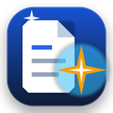

<div align="center">



# Asistente Editorial para Microsoft Word + Suite de Ingeniería Documental Universal

*Copiloto inteligente nativo en Word para redacción, control de cambios, cruce con Excel, maquetación avanzada, auditoría de coherencia, generación de gráficos y análisis cuantitativo bajo normas APA 7ma edición.*

[](https://github.com/)
[](https://opensource.org/licenses/MIT)
[](https://www.microsoft.com/microsoft-365/word)
[](https://aistudio.google.com/)
[](https://nodejs.org/)
[](https://www.python.org/)
[](https://apastyle.apa.org/)

</div>

---

## 🌟 Visión del Proyecto

Este proyecto, desarrollado por **Renzo David Chumacero Yanayaco**, es una **solución integral y multifuncional** diseñada para transformar Microsoft Word en un entorno editorial inteligente. 

No está limitado a un solo tipo de documento ni a una sola tarea: está concebido para **tesis universitarias, informes técnicos, memorándums ejecutivos, artículos científicos y documentos legales**, con una arquitectura abierta adaptable a **cualquier motor de Inteligencia Artificial** (Google Gemini, OpenAI GPT-4o, Anthropic Claude o modelos locales con Ollama) y con una estricta política de **cero metadatos de IA**, preservando la autoría humana en todo momento.

---

## ⚡ Las 14 Capacidades del Sistema

```
┌────────────────────────────────────────────────────────────────────────┐
│             SUITE DE INGENIERÍA DOCUMENTAL PARA WORD                   │
├───────────────────────────────────┬────────────────────────────────────┤
│ 1. Lectura Integral de Manuscritos│ 8. Auditoría Lógica y Numérica     │
│ 2. Control de Cambios (Track Ch.) │ 9. Gráficos Nativos y Visuales     │
│ 3. Reescritura por Tonos de Estilo│ 10. Maquetación (Márgenes/Secc.)   │
│ 4. Inserción de Texto en Tiempo R.│ 11. Tablas Avanzadas (APA 7/Merge) │
│ 5. Gestión de Comentarios e Hilos │ 12. Diagramas y Formas Vectoriales │
│ 6. Búsqueda Web en Vivo (Citas)   │ 13. Automatización por Scripts     │
│ 7. Cruce con Excel / PPTX / CSV   │ 14. Procesamiento por Lotes Masivo │
└───────────────────────────────────┴────────────────────────────────────┘
```

1. 📖 **Lectura Integral del Documento:** Analiza el texto completo de archivos extensos de más de 200 páginas sin necesidad de copiar y pegar manualmente.
2. 📝 **Control de Cambios Nativo (Track Changes):** Activa y desactiva el modo de revisión de Word (`trackAll` / `off`). Sugiere adiciones y eliminaciones con marcas formales para aceptar o rechazar individualmente.
3. ✍️ **Edición y Reescritura de Selección:** Modifica el tono (formal, académico, ejecutivo, persuasivo), resume, expande o corrige la gramática y estilo de cualquier fragmento marcado.
4. 📄 **Inserción de Texto en Tiempo Real:** Redacta párrafos, introducciones, discusiones o conclusiones directamente en el cuerpo del documento.
5. 💬 **Gestión de Comentarios e Hilos:** Lee todos los comentarios del documento, responde dentro de los hilos de revisión y propone mejoras basadas en ellos.
6. 🌐 **Búsqueda Web en Vivo (Grounding):** Consulta fuentes actualizadas en internet desde el panel lateral e incorpora referencias directas al texto.
7. 📊 **Contexto Cruzado con Otros Archivos:** Zona de arrastre (*Drop Zone*) para adjuntar libros de **Excel (`.xlsx`)**, archivos **CSV**, presentaciones de **PowerPoint** o textos planos, permitiendo cruzar cifras y validar datos en Word.
8. 🔍 **Comprobación de Coherencia y Estilo:** Auditoría automática que detecta contradicciones lógicas entre capítulos, vacíos argumentales, errores de cálculo muestral y rupturas de la persona gramatical.
9. 📈 **Inserción de Gráficos Nativos y Visuales:** Genera y coloca figuras de barras comparativas, líneas de tendencia o diagramas de sectores en alta resolución con normas APA 7.
10. 📐 **Control de Maquetación Avanzada:** Configura márgenes (APA 7ma Edición 2.54 cm en los 4 lados, Normal, Estrecho), orientación de página (vertical u horizontal) y saltos de sección.
11. 📋 **Manipulación y Formateo Avanzado de Tablas:** Crea tablas con líneas horizontales formales, sin bordes verticales (estándar APA 7), sombreados personalizados, combinación de celdas (*merge*) y notas explicativas.
12. 🔷 **Inserción de Formas y Diagramas:** Esquematiza diagramas de flujo y modelos conceptuales.
13. ⚙️ **Automatización y Scripts:** Ejecución de rutinas de procesamiento de datos en Python o PowerShell sin intervención manual.
14. 🗂️ **Edición por Lotes Multiarchivo:** Procesa carpetas enteras de documentos `.docx` simultáneamente para auditorías masivas, sustituciones globales y estandarización tipográfica.

---

## 🤝 Modo Conversación en Tiempo Real: "Pregunta Antes de Modificar"

El panel lateral incorpora una pestaña de **💬 Chat Interactivo** diseñada para el trabajo en pareja con el autor:

* **Diálogo Previo:** Antes de alterar párrafos o capítulos, el asistente analiza la situación, explica el motivo de la mejora y formula **preguntas directas, cortas y fáciles de entender**.
* **El Usuario Decide:** Puedes debatir, pedir que ajuste el enfoque o elegir entre opciones.
* **Tarjetas de Acción:** Una vez acordado el cambio, el asistente genera tarjetas interactivas con botones:
  * `[✦ Reemplazar selección en Word]`
  * `[✦ Insertar al final del documento]`
  * `[✦ Insertar Tabla en Word]`
  * `[✦ Insertar como Comentario]`
  Todo se aplica en tiempo real sobre tu documento abierto.

---

## 📁 Estructura del Repositorio

```text
para-subir/
│
├── README.md                           # Documentación maestra del proyecto
├── .gitignore                          # Protección de credenciales y archivos locales
├── subir-a-github.bat                  # Script de 1 clic para subir todo a GitHub
│
├── word-addin/                         # ✦ COMPLEMENTO DE MICROSOFT WORD
│   ├── manifest.xml                    # Manifiesto de Office (Cinta y Panel lateral)
│   ├── server.js                       # Servidor HTTPS Express con despachador Multi-IA
│   ├── package.json                    # Dependencias Node.js
│   ├── .env.example                    # Plantilla de claves API
│   ├── 1-instalar-dependencias.bat     # [1 clic] Instala librerías con npm
│   ├── 2-generar-certificados-ssl.bat  # [1 clic] Configura SSL seguro para localhost
│   ├── 3-registrar-en-word.bat         # [1 clic] Registra el complemento en Word
│   ├── ARRANCAR-LOCALHOST-3000.bat     # [1 clic] Arranca el servidor con consola
│   ├── ARRANCAR-SEGUNDO-PLANO.vbs      # [1 clic] Arranca silencioso en segundo plano
│   ├── iniciar_localhost_3000.ps1      # Script de activación instantánea en 1 línea
│   ├── README.md                       # Documentación interna del Add-in
│   └── public/                         # Interfaz gráfica moderna (HTML5/CSS3/Office.js)
│       ├── taskpane.html
│       ├── taskpane.js
│       ├── taskpane.css
│       └── assets/ (iconos ejecutivos en 16, 32, 80, 128 y 512 px)
│
├── skill/                              # ✦ SUITE DE INGENIERÍA DOCUMENTAL Y AUDITORÍA
│   ├── SKILL.md                        # Protocolo y directivas maestras
│   ├── README.md                       # Guía de instalación en entornos de trabajo
│   ├── references/
│   │   ├── guia_arquitectura_multi_ia.md # Arquitectura y adaptación a cualquier IA
│   │   ├── manual_operativo_auditoria.md # Manual de auditoría metodológica y editorial
│   │   ├── metodo_tandazo.md           # Estándares psicométricos y principio de normalidad
│   │   └── apa7_format_rules.md        # Reglas estrictas de tablas y figuras APA 7
│   └── scripts/
│       ├── batch_processor.py          # Motor de procesamiento masivo por lotes
│       ├── advanced_table_engine.py    # Motor de tablas avanzadas (APA 7, merge, cebra)
│       ├── chart_generator.py          # Generador de gráficos de alta resolución
│       ├── layout_engine.py            # Motor de márgenes, orientación y saltos
│       ├── analyze_pipeline.py         # Motor de cálculo estadístico (t, Wilcoxon, Cronbach)
│       ├── inject_spss_to_word.py      # Inyector directo a Word (.docx)
│       ├── iniciar_localhost_3000.ps1  # Lanzador automatizado del servidor para Word
│       ├── detect_spss.ps1             # Localizador automático de IBM SPSS Statistics
│       ├── ensure_environment.ps1      # Gestor automático de dependencias Python
│       ├── export_word_apa7.ps1        # Generador de informe Word APA 7 independiente
│       ├── export_excel_report.ps1     # Generador de reportes de trabajo en Excel
│       └── generate_spss_syntax.py     # Generador de sintaxis oficial SPSS (.sps)
│
└── ejemplos/                           # ✦ DATOS Y MODELOS DE PRUEBA
    ├── datos_ejemplo_prepost.csv       # Matriz real anonimizada (32 sujetos, 18 reactivos)
    └── README.md                       # Guía para probar la suite en 1 minuto
```

---

## ⚡ Instalación en 4 Pasos (Windows)

1. Abre la carpeta `word-addin`.
2. Ejecuta **`1-instalar-dependencias.bat`** (descargará las librerías necesarias con npm).
3. Ejecuta **`2-generar-certificados-ssl.bat`** (configura HTTPS local; si Windows muestra una ventana de confirmación, selecciona **Sí**).
4. Ejecuta **`3-registrar-en-word.bat`** (registra el complemento en Microsoft Office).

---

## 🚀 Cómo Activar el Servidor `https://localhost:3000/` al Instante

Tienes tres opciones según tu preferencia:

* **Opción A (Recomendada con consola de control):**  
  Doble clic en **`ARRANCAR-LOCALHOST-3000.bat`**.
* **Opción B (Modo silencioso / Sin ventana negra):**  
  Doble clic en **`ARRANCAR-SEGUNDO-PLANO.vbs`**.
* **Opción C (Por comando o para que la IA lo active de golpe):**  
  ```powershell
  powershell -ExecutionPolicy Bypass -File "word-addin\iniciar_localhost_3000.ps1"
  ```
  *(Este comando verifica si el puerto 3000 ya está activo; si no lo está, inicia Node en segundo plano y confirma la disponibilidad en 2 segundos).*

---

## 🌐 Configuración Multi-IA (Pestaña ⚙️ Ajustes)

En el panel lateral de Word puedes seleccionar tu motor de inteligencia preferido:

| Proveedor | Modelos disponibles | Clave requerida |
| :--- | :--- | :--- |
| **Google Gemini** | `gemini-3.8-flash`, `gemini-3.1-pro-preview` | Gratuita en [Google AI Studio](https://aistudio.google.com/) |
| **OpenAI** | `gpt-4o`, `gpt-4o-mini` | Clave de OpenAI |
| **Anthropic** | `claude-3-5-sonnet-20241022` | Clave de Anthropic |
| **Modelos Locales** | Llama 3, Mistral, Qwen (vía Ollama) | Sin costo (Endpoint: `http://localhost:11434/v1`) |

---

## 🛡️ Cero Rastros de IA

* **Autoría Humana Personalizable:** Puedes configurar el nombre del revisor en la pestaña **⚙️ Ajustes** (por defecto *Renzo Chumacero*). Todas las marcas de control de cambios y comentarios en Word llevarán tu nombre.
* **Sin Huellas Digitales ni Marcas de Agua:** Ningún texto ni archivo contiene advertencias de bots, disclaimers artificiales ni comentarios de autoría de IA.

---

## 📄 Licencia

Este proyecto se distribuye bajo la licencia **MIT**. Eres libre de usarlo, adaptarlo y compartirlo para investigaciones académicas, desarrollo de software o uso profesional.
