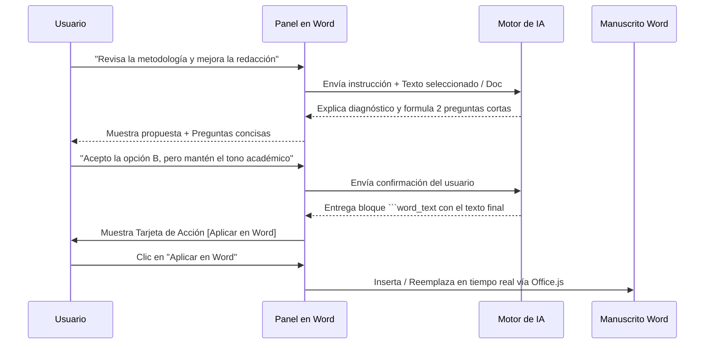

# Arquitectura Multi-IA y Guía de Integración Universal

Este documento describe la arquitectura abierta y desacoplada del **Asistente Editorial y Suite de Ingeniería Documental para Microsoft Word**, permitiendo su interoperabilidad con cualquier modelo de Inteligencia Artificial (comercial, abierto o local) y su uso desde el panel lateral de Word o desde entornos de desarrollo como Antigravity, Cursor, Claude Code o terminales CLI.

---

## 1. Diagrama de Arquitectura

```
┌─────────────────────────────────────────────────────────────┐
│                 MICROSOFT WORD (Desktop / Web)              │
│  ┌───────────────────────┐       ┌───────────────────────┐  │
│  │  Documento Activo     │ <---> │  Panel Lateral (HTML) │  │
│  │  - Texto / Párrafos   │       │  - Chat Interactivo   │  │
│  │  - Track Changes      │       │  - Selección/Edición  │  │
│  │  - Comentarios Nativos│       │  - Cruce con Excel    │  │
│  │  - Tablas / Gráficos  │       │  - Maquetación        │  │
│  └───────────────────────┘       └───────────────────────┘  │
└──────────────────────────────▲──────────────────────────────┘
                               │ HTTPS :3000 (Office.js API)
┌──────────────────────────────▼──────────────────────────────┐
│             SERVIDOR LOCAL BACKEND (server.js)              │
│  - Dispatcher Multi-IA (Gemini / OpenAI / Claude / Ollama)   │
│  - Inyector de Contexto (Documento + Excel + Selección)      │
│  - Parser de Tarjetas de Acción (Text, Table, Comment)       │
│  - Motor de Certificados SSL localhost                       │
└──────────────────────────────▲──────────────────────────────┘
                               │ APIs REST / Sockets
┌──────────────────────────────▼──────────────────────────────┐
│                     PROVEEDORES DE IA                       │
│  ┌─────────────────┐  ┌─────────────────┐  ┌─────────────┐  │
│  │  Google Gemini  │  │  OpenAI / GPT-4 │  │  Anthropic  │  │
│  │  (Flash / Pro)  │  │  (Compatible)   │  │  Claude     │  │
│  └─────────────────┘  └─────────────────┘  └─────────────┘  │
│  ┌───────────────────────────────────────────────────────┐  │
│  │  Modelos Locales / Privados (Ollama, LM Studio)       │  │
│  └───────────────────────────────────────────────────────┘  │
└─────────────────────────────────────────────────────────────┘
```

---

## 2. Compatibilidad con Proveedores de IA

El backend (`server.js`) implementa un despachador unificado que permite alternar entre proveedores cambiando únicamente el parámetro `provider` en la pestaña **⚙️ Ajustes** o en las peticiones API:

### A. Google Gemini (Predeterminado)
* **Modelos soportados:** `gemini-3.8-flash`, `gemini-3.1-pro-preview`.
* **Capacidades nativas:** Búsqueda web en vivo (*Google Search Grounding*), ventana de contexto masiva (hasta 1 millón de tokens para libros y tesis enteras) y reintentos con respaldo exponencial.
* **Configuración:** Variable `GEMINI_API_KEY` en `.env` o en la interfaz.

### B. OpenAI y Modelos Compatibles (ChatGPT)
* **Modelos soportados:** `gpt-4o`, `gpt-4o-mini`, `o1`.
* **Configuración:** Variable `OPENAI_API_KEY`.
* **Ruta de la API:** `https://api.openai.com/v1/chat/completions`.

### C. Anthropic Claude
* **Modelos soportados:** `claude-3-5-sonnet-20241022`, `claude-3-opus`.
* **Configuración:** Variable `ANTHROPIC_API_KEY`.
* **Ruta de la API:** `https://api.anthropic.com/v1/messages`.

### D. Modelos Locales y Privados (Ollama / LM Studio / OpenRouter)
* **Modelos soportados:** `llama3`, `mistral`, `qwen2.5`, `deepseek-r1`.
* **Privacidad 100 % local:** Ningún dato sale de tu computadora; ideal para documentos confidenciales, tesis con secreto industrial o expedientes legales.
* **Configuración:** Seleccionar proveedor `local_ollama` y colocar el endpoint local (ejemplo: `http://localhost:11434/v1`).

---

## 3. Protocolo Colaborativo: "Pregunta Antes de Modificar"

Para evitar alteraciones no deseadas sobre manuscritos extensos, la IA sigue un flujo en 3 etapas:



### Reglas de Formato de Salida para la IA:
* **Para texto final:** Enmarcar en ` ```word_text ... ``` `. El panel renderiza automáticamente botones de reemplazo o inserción al final.
* **Para tablas nativas:** Enmarcar en ` ```json_table {"headers": [...], "rows": [...]} ``` `.
* **Para comentarios de revisión:** Enmarcar en ` ```word_comment ... ``` `.

---

## 4. Política Estricta de Cero Rastros de IA

1. **Metadatos de Archivo:** Todos los comentarios y marcas de control de cambios se guardan bajo el nombre del autor humano configurado (`inputAuthorName`, por defecto *Renzo Chumacero*).
2. **Propiedades del Documento:** No se insertan etiquetas, marcas de agua ni comentarios ocultos de sistemas automatizados.
3. **Registro Científico y Humano:** La redacción generada utiliza un tono académico formal en tiempo pasado y voz impersonal (*«se analizó»*, *«se comprobó»*).
